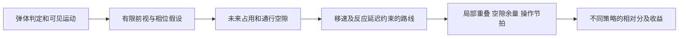
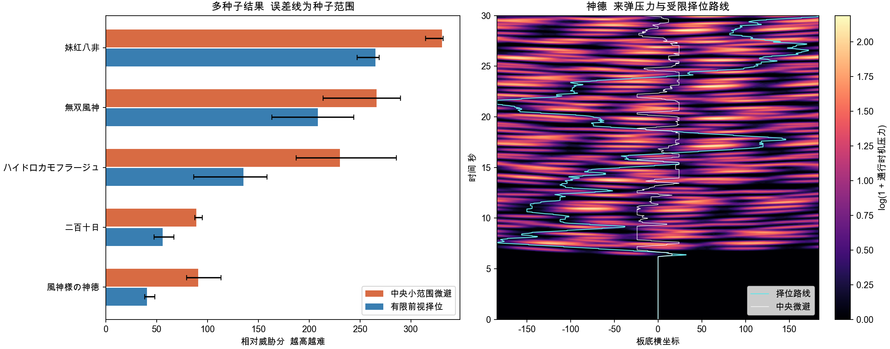

# 优秀符卡的设计共性与威胁度

本文保留原有弹设术语，并根据 TH31、TH34、TH35 的现有符卡补充设计分析和威胁度 V2。分析对象是符卡，非符不用于推导设计共性；妹红八非仅作为指定的底力标定例外。所有指标用于描述和设计自制卡，不据此改动原作移植的弹数、速度、时序、判定或血量。

## 零、发弹类型的定义
发弹类型按发弹方向主要可分为三类，分别是自机狙，随机弹，固定弹。自机狙指子弹方向与自机有关的弹幕，随机弹指子弹方向在某个角度范围内随机的弹幕，固定弹指子弹方向固定的弹幕。通常记发弹源到自机方向的角度为dir。
发弹时通常还包含way数，即在同一帧发的子弹数量，子弹在某个角度范围内均匀排布，如3way指在发弹时刻同时发3发子弹，如在(0,180)内发3way子弹，则子弹方向为0,90,180
自机狙复合way数时，通常会使得其角度范围的中心为dir，设角度范围为(dir-a,dir+a),则易知当way数为奇数时，dir方向一定有一颗子弹，通常称为奇数狙；way数为偶数时，dir方向一定没有子弹，通常称为偶数狙
自机狙和固定弹都可以附加偏移量，自机狙附加一个较小的随机量时称泛狙，附加一个固定角度时称为偏角狙；固定弹附加一个随机量时称为角度随机的固定弹，或简称角随固

## 一、展开的定义
展开指一组为了达到特定目的而实现的子弹。特定目的通常包括限位，威胁两种。
限位指一组子弹通过周期性的位置分布，疏密分布，速度分布，达到自机在某些区域一定会与子弹碰撞、或所需躲避要求远超人类能力范围、或所需躲避要求明显高于其他区域的效果，进而导致自机倾向于在某些随时间变化的特定区域躲避子弹，这些特定区域通常称为安全区，其他区域通常称为危险区
威胁指一组对安全区内自机有实际躲避要求的子弹，称为组=子弹威胁度，可通过下述方法计算子弹威胁度

## 二、旧版子弹威胁度

以下是 `tools/threat.lua` 所使用的历史定义。它适合保留旧报告的口径，不作为所有优秀符卡的合格线。新版度量见第八节。
子弹威胁度指在自机所在位置一定时间内会被子弹打到的帧的数量乘以一个权重，权重与该帧时自机周围的16个方向是否存在(5+自机碰撞半径或半边长)像素以上的空隙有关，存在空隙的方向称为安全方向，否则为危险方向，权重为危险方向/16
特别地，对于奇数狙弹幕，由于其一定会打中不动的自机，而且只需要微移就能躲避，故其不纳入频率计算；
但其会导致自机只能单向微移，因此其应当纳入安全方向计算，其一定会封死16个方向中的9个，即发弹源与自机的连线对应的2个方向以及连线的某一侧全部7个方向;
由于每次一整轮狙时自机全程只能单向微移，故该7个方向在一整轮狙时都固定，具体取哪7个方向应当将两种方案分别跑一遍取最小值

## 三、合理的展开

合理展开应当让玩家能够理解危险如何形成，并通过站位、路线、时机或精度作出有效回应。可以用“区域选择”和“区域内躲避”分析这两种功能，但不要求另外添加一层独立限位。板底区域相对稳定、主要考验微避的底力卡，同样可以是完整且优秀的展开。

## 四、限位的设计

较容易应对的区域可以周期性变化，如左→右交替，也可以相对稳定。判断区域是否可用，必须同时考虑入口、到达时间、能停留多久以及之后能否离开，不能只判断某一帧是否存在空点。
部分设计中部分安全区都可以随时间缩小，但需要存在合理的最小值；特别地，随时间缩小的安全区允许始终只有同一个安全区存在，不存在安全区周期，如允许仅存在一个随时间缩小的圆作为安全区
危险区的营造尽可能使用子弹实现，通过子弹周期性的位置分布，疏密分布，速度分布，达到自机在某些区域一定会与子弹碰撞、或所需躲避要求远超人类能力范围、或所需躲避要求明显高于其他区域的效果
显然地，两组独立的限位的复合会导致最终安全区为两组限位安全区的交集，最终危险区为两组限位危险区的并集。因此可通过多组限位的复合实现复杂的安全区周期，如限位A在时间点1、2的安全区在左，3、4的安全区在右，如此循环；限位B在时间点0、1的安全区在下，2、3的安全区在上，4、5的安全区在下，如此循环，则时间点1、2、3、4的安全区分别在左下、左上、右上、右下，如此循环

## 五、威胁的设计

关注玩家同一时刻必须独立处理多少种运动规律，而不是场上有几个发射源。两组同相位、同速度的弹可以被读成一层；一组弹在减速、折返、交叉后，也可能形成多个需要分别处理的到达层。

旧版“同时 1 至 2 组、威胁度 0.5 至 1.5”保留为旧工具的经验口径，不用于否定原作符卡。难度、设计质量和可读性分别评价；新版相对分与旧版数值不能直接换算。

## 六、总体设计原则
设计符卡时应当从角色身上提炼元素设计符卡锚点
弹幕设计应当符合符卡锚点，可以从子弹类型，子弹形成的形状等方向契合
限位与威胁都应当使用子弹自然实现

## 七、TH31 TH34 TH35 符卡的设计共性

### 分析范围

按当前注册条目排除非符和名称中含“道中”的搬运载体，TH31 有 79 条、TH34 有 68 条、TH35 有 38 条，共 185 条符卡登记。登记范围来自运行脚本后的 `boss.card.add`，不靠日文卡名或文件中的注释数量判断。这里讨论的是这些符卡家族反复采用的设计方法，不是要求每张卡同时具备下列全部特征。

这些符卡的重要共性是：**复杂画面由少数可学习的规则生成；玩家能通过读图和选择位置，把全局压力转化为局部可处理的问题，最后再用操作精度完成躲避。** 困难来自这些环节的组合，而不是单独来自弹数。

### 视觉图案和实际解法使用同一套结构

旋转、对称、环、扇、弹流和子机轨道既负责构图，也决定缝隙往哪里走、何时重叠、哪里将变稀。玩家观察到的规律直接参与决策，所以学会一张卡通常意味着学会预测，而不是只记住“危险时往左走”。

例如 TH35 神德的五台枪、两种出弹轨道、三拍出弹及停顿后加速共同产生花形和层间疏密。寻找单层区的解法来自同一套几何关系，不需要额外画一个安全圈。TH34 的结界类符卡也把轨道、切线出弹、快慢层的关系作为主要阅读对象。

### 难度集中在实际遭遇处

全屏有很多弹，不意味着每个位置都同样难。环的多数部分可能远离自机；两条弹流可能各自很好躲，交叉时却显著压缩可操作余量。优秀展开会让玩家判断“我将遇到哪部分”，而不是要求同时处理整个画面。

这也解释了为什么“大幅移动”不应自动加很多难度分。提前横移到稀薄区，可能比原地挤一个重叠缝容易得多。反过来，移动距离只有几像素，但发生在快弹之间、容错时间很短，也可能很难。

### 空隙是随时间连续变化的通道

有效空隙包含四个条件：判定表面之间放得下自机；到达时还开着；途中能安全经过；停留后仍有后续选择。一个漂亮的瞬时空点，若必须穿过正在闭合的弹墙才能到达，就不是当前可用的解。

减速、停顿、再加速和折返尤其强调这一点。当前速度很低的弹，可能即将转化为主要威胁；眼前很密的一层，也可能在自机到达前散开。TH31 的时停、隐显切换和 TH34 的多段运动都要求把“当前状态”放进相位中理解。

### 弹层的关系比层数本身更重要

同向、同相位的弹群容易被读成一张移动的网；速度不同、旋向相反或到达时间接近的弹群，则要求分别外推再合并判断。真正增加难度的是独立规律的交叉、通道碎裂和可用缝隙的寿命缩短。

因此，不能用“发射了六路，所以有六组威胁”代替分析，也不应为了凑两层而给每张底力卡添加背景弹。光学的成对扇形与环、二百十日的两路反旋弹，以及二重黑死蝶的分批刹停和转向，各自用不同方式组织层间关系。

### 阶段变化有规则 但不等于所有信息始终可见

符卡会用固定节拍、成对发射、速度过渡、颜色或动作提示，使变化可以学习。变化本身可以很难：隐身、时间停止、延迟激活并不因为“暂时看不见危险”就失去设计价值，其核心是玩家能否理解相位并提前准备。

TH31 幻胧月睨的可见、隐身、淡入、恢复判定是相位机；紧缩世界则要求在冻结前处理位置。这样的卡不能用“未来一直按当前速度飞”的预测器判断，更不能把无判定阶段当成一张卡始终空旷的证据。

### 节奏和成长保持题目的一致性

缩短发弹间隔、增加环数、解锁新层或改变旋向，常常是在已有规则上提高压力。玩家先建立理解，再承受更高精度或更少余量；卡片仍然能辨认出自己的核心题目。

评价时应同时看典型压力和持续高压段。把开场演出、松散过渡和最后一波简单平均，会掩盖后期压力；只取单帧峰值，又会把偶然交叉夸大为整张卡的难度。血量、输出位置和持续时间还会进一步改变实际通关成本。

### 共性与代表证据

| 符卡 | 主要结构 | 对设计分析和度量的启示 |
|---|---|---|
| TH31 幻胧月睨 | 两组掩码共同推进隐显相位，恢复时重开判定 | 可见性、碰撞与未来相位分别建模，不能按当前亮点数量计分 |
| TH31 梦想天生 | 多台漂移使魔反复扇射，间隔逐步缩短 | 源数量不等于独立遭遇层；需要比较到达节拍与局部可用区域 |
| TH31 紧缩世界 | 扇形减速、折向、冻结与解冻发弹 | 冻结前的预站位是解法的一部分，冻结时不能假设自机还能移动 |
| TH34 紫奥義「弾幕結界」 | 公转子机的切线快弹与偏移慢弹 | 轨道、出弹方向和快慢层共同决定局部通道 |
| TH34 生与死的境界 | 血量阈值逐层解锁，末段加强 | 分阶段统计；以初始血量空跑不能代表全部阶段 |
| TH34 二重黑死蝶 | 分批发射后刹停、反向转弯、再加速 | 静态密度和当前速度都不足以描述即将到达的压力 |
| TH35 光学 | 成对旋转扇形与另一路环，具有固定轮次节拍 | 必须区分规则弹群的可读性与局部叠层压力 |
| TH35 二百十日 | 两路相反旋转及随轮次变化的角度扰动 | 需要预测两层未来交汇，不能简单把两个速度向量相加 |
| TH35 無双風神 | 随机偏移散弹与后段使魔、激光循环 | 同向弹群初现位置分散，局部缝隙较难作为一条整齐弹线阅读 |
| TH35 神德 | 五枪、多拍、延迟加速形成相间的单层区与重叠区 | 预测低叠层区并提前换位，应当降低剩余操作威胁 |

对应源码入口：[TH31 幻胧月睨](mod/GAME/th31.lua#L3016)、[梦想天生](mod/GAME/th31.lua#L6351)、[紧缩世界](mod/GAME/th31.lua#L7687)；[TH34 弾幕結界](mod/GAME/th34.lua#L6336)、[生与死的境界](mod/GAME/th34.lua#L6477)、[二重黑死蝶](mod/GAME/th34.lua#L6786)；[TH35 神德枪](mod/GAME/th35.lua#L262)、[神德主循环](mod/GAME/th35.lua#L390)、[光学](mod/GAME/th35.lua#L1570)、[二百十日](mod/GAME/th35.lua#L1897)、[無双風神](mod/GAME/th35.lua#L1944)。这里的机制依据现有实现；设计作用的归纳是对这些机制的解释。

### 用于新卡设计时的检查顺序

先确定角色锚点和一种主要阅读规则，再检查玩家能否通过这条规则预测下一次遭遇。之后检查弹隙的宽度、寿命和可达性，再决定是否需要另一种不同功能的弹层。最后分别验证中央微避、提前换位、错误站位三种情况，让正确理解确实能降低操作成本。

不要倒过来先堆弹，再用一条数值合格线证明设计合理。图案复杂度、操作难度、解法丰富度和角色表现力是不同维度；威胁度只描述其中一部分。

## 八、威胁度 V2 的设计

### 度量对象是策略下的剩余压力

将威胁度定义为：在指定自机能力、观察假设和策略下，持续处理到达弹幕所需的空间精度、时间精度与阅读负荷。记为 `T(弹幕，自机，策略，预测能力)`，不把它当作只由卡名决定的常数，也不把它解释为符卡质量或通关概率。

至少同时输出三种结果：钉死中央、中央附近微避、允许提前换位。钉死中央仅用于暴露不动会怎样，不能代替“在板底中央躲”；中央微避允许连续小幅移动。神德应比较中央微避与择位后的剩余压力，不能把前者直接作为掌握解法后的难度。

### 先建立未来占用 再寻找可达弹隙

完整模型应使用 `x、y、时间` 三维占用场。弹体用实际判定边界，激光用随时间变化的线段或曲线管，当前无判定、将来重新激活的弹则需要相位预测。位置由实际轨迹差分或运动模型推进，不只读取引擎的 `vx/vy`，因为手算位置的弹可能把这两个字段一直置零。

每个未来时间片先从占用区中扣除自机判定和控制误差，再分割出连通空隙；随后在相邻时间片之间连接可达区域。连接必须满足移速、移动锁定、转向或指令延迟，以及整段移动途中没有穿越障碍。只有节点安全、但边会穿弹的路线不能算可行。

这张图需要回答四个问题：缝有多宽；到达时是否仍存在；沿路能否过去；进去后还能停留或离开多久。稀薄区不是“弹最少的一格”，而是未来一段时间内局部叠层较少、通道较宽，并且当前来得及进入的区域。



### 保留独立的解释参数

| 参数或读数 | 含义 | 为什么需要 |
|---|---|---|
| 空间余量 `m` | 自机到弹体判定表面的有符号距离 | 区分小弹与大弹，避免只按弹心距离判断 |
| 连通缝宽 `g` | 扣除自机判定后的可通行宽度 | 区分宽松弹隙、细缝和被截断的通道 |
| 缝隙寿命 | 入口持续开放的时间及关闭速度 | 一个很宽但马上合拢的缝未必好用 |
| 通行时机压力 `F` | 把速度、时间误差和附近弹体一起考虑的局部负荷 | 快弹停留短，不能因此被低估 |
| 重叠压力 `O` | 最近单颗弹以外，其余近邻弹的共同影响 | 描述层间交叉导致的操作余量损失 |
| 阅读负担 `U` | 是否能用少数稳定规则预测下一批间隙 | 整齐弹线与同向散乱弹云不能只按数量等价 |
| 操作节拍 `K` | 局部接触范围内，快弹带来的时间精度要求 | 区分慢速挤缝与高速连续微避 |
| 可达性 `V` | 在速度和反应延迟下，目标区及入口能否到达 | 防止给不可达空隙减分，或把瞬移当作解法 |
| 择位收益 `B` | 中央策略与合法择位策略的压力差 | 直接表达神德找到单层区后的难度下降 |
| 高压段与种子范围 | 持续窗口的高分位和多次随机结果 | 区分典型难度、阶段成长及偶然坏波 |

`O` 不应最终等同于独立弹层数量。同一几何结构上的相邻弹可以相关；成熟实现需要结合轨迹方向、相位、到达时间和预测相关性分组。原型中的近邻重叠与初现散布只是这两项的可计算代理。

### 预测应当分清已知运动和未知随机

线上版本只能根据已经看到的弹、已学会的相位规则和发弹分布预测。直线、加速、转弯、停顿再启动应使用不同运动假设；不确定时扩大未来占用范围，或对多个假设分别规划。尚未生成的随机弹不能提前获知其具体方向和落点。

奇数狙不再通过名称或“看起来朝向自机”直接豁免。足够早到达、只需微移的狙弹，会通过可用通道与较大的时间余量自然得到较低压力；来不及反应的贴脸狙仍需要计入。

初见模式和熟悉规则模式应分开。隐身切换、时停、固定延迟发射可以在熟悉模式中预测，但不能假装玩家第一次见到时就已经知道。若未来弹幕依赖自机位置，还必须在每次策略改变后重新推进发弹逻辑，而不是拿中央站位产生的弹场任意平移自机。

### 当前离线原型的实现边界

[模型](tools/threat_v2/model.py)、[采样器](tools/threat_v2/trace.lua)和[复测入口](tools/threat_v2/run.py)实现了一版用于这组底力参照卡的原型。它分析 `y=-176` 的一条板底扫描线，横坐标为 `[-184,184]`，以 2 像素间隔建图；这不是完整二维躲避器。

采样同时纳入 `NewSimpleBullet`、对象式弹幕、不可消弹和本组参照中出现的直线激光。圆形判定直接使用半径；非圆弹取现有半轴最大值作保守圆近似，直线光采用保守矩形近似。未知判定尺寸会使本轮评分报错，不静默按点弹处理。绘制大小不参与判定。

原型从 Lua 逐帧运行记录中取得加速、转向与停顿后的实际位置，每两帧采样一次，并用采样间扫掠防止漏掉快弹。规划前视最多 120 帧，保留已承诺的 12 帧输入，再每 12 帧重规划；位移上限为 4 像素每帧。中央微避限制在 `|x|≤24`，择位策略使用整条合法板底。参考自机半径取 0.75 像素，这是本轮标定假设，可以换成所测自机的值。

**前视是离线的理想物理预测**：只允许已经出现的子弹进入预测，但其之后的轨迹取自记录，尚未实现仅凭观测外推的因果预测器。原型也没有因自机换位重新运行瞄准和 Boss 游走。神德本轮枪形由 Boss、相位和随机源决定，适合观察择位收益；其他存在自机反馈的模式，其跨站位结果只能视为条件估计。表中的占用率是保守扫掠代理，不是原生引擎实测死亡率。

这些边界使它适合验证“弹隙、时机、叠层和择位应共同计分”的方向，不能据此给 185 条符卡全部排出可靠难度，也不能声称图中的路线是真人可执行的不撞证明。

### 原型的计算式

设某颗弹在位置 `x` 的扫掠表面余量为 `m_i`，实际差分速度为 `v_i`。距离使用世界像素，时间使用逻辑帧（60 帧每秒），速度为像素每帧。空间控制误差尺度取 `σx=3` 像素，通行时机误差取 `σt=3` 帧：

```text
ℓ_i = σx + v_i σt
q_i = exp(-max(m_i,0)/ℓ_i) × max(v_i/2, 0.15)
      仅保留 m_i ≤ 3ℓ_i 的近邻
F = Σ q_i
O = max(F - max(q_i), 0)
P = (12 / (g+12))²
```

`ℓ_i` 把相同时间误差换算成随速度增大的空间要求；通量因子则修正“快弹停留较短，瞬时密度较低”的偏差。`P` 在缝很窄或已经闭合时升高，不用全屏平均密度替代局部通道。

阅读代理按 8 帧初现窗口、20 度方向区间及颜色组成小簇，计算至少三颗同向弹初现位置的空间散布，再取这些簇的中位数 `U`。相近时刻的同向弹来自更分散的位置时，需要分别估计缝隙，因而增加阅读负担：

```text
R = 1 + min(U/28, 3)
K = (v_nearest/4)²，最近弹表面余量小于 16 像素时计入，否则为 0
A = 0.7 mean(F) + 0.35 mean(O) + mean(P) + 2 × 扫掠占用比例
T = 100 × [R A + 1.5 mean(K)]
```

`U` 是散布的代理，不是真正的随机熵：稳定的多源结构也可能有较大散布。`K` 单独保留操作节拍，防止把所有速度效应都折算成空间密度。上述系数是用指定参照组选择的共同参数，不是人体实验常数；计算式不读取卡号、名称或指定的排名。

规划使用局部压力、缝宽以及很大的碰撞代价，并对跨过占用格的移动边加罚。最终分数仍评估成功避开弹之后所剩的余量与节拍，所以“机器人没有碰到弹”不会直接得到零威胁。若当前前视窗口内没有无占用解，原型继续给出最小暴露路线，并报告占用比例；这类路线不能叫作安全通道。

统计窗口从中央首次出现局部来弹压力开始，同一张卡的不同策略使用同一时间窗。每张先跑指定帧数，并在卡片时限处截断；本轮不模拟射击击破。因此这些分数描述持续处理弹幕的相对压力，血量、输出位置、Bomb、时停操作和整卡通关成本应另报。

## 九、指定参照组的标定结果

### 难度顺序和策略口径

采用给定的底力顺序作为标定监督：

```text
妹红八非 > 「無双風神」 > 光学「ハイドロカモフラージュ」
         > 風神「二百十日」 > 「風神様の神徳」
```

妹红八非是非符，只进入这项难度标定，不作为第七节符卡设计共性的证据。其卡号为 391；其余依次为 3607、3601、3606、3600。第一至第四张使用中央附近微避，神德使用可达稀薄区择位。这是给定参照策略，不是对每张卡的真实最优解作出的证明；原型也同时保存所有策略的结果，供比较。

### 五种子的典型值符合给定顺序

标定种子为 `20260916、11111、98765、31415、777`。每张取最多 1800 帧，無双風神在 1080 帧时限截断。下表取五个种子的中位数，分数越高表示剩余威胁越高，可以超过 100，不是百分比。

| 参照卡 | 策略 | 典型威胁分 | 种子范围 |
|---|---|---:|---:|
| 妹红八非 | 中央附近微避 | 330.6 | 314.6 至 331.8 |
| 「無双風神」 | 中央附近微避 | 266.3 | 213.7 至 290.0 |
| 光学「ハイドロカモフラージュ」 | 中央附近微避 | 230.2 | 187.0 至 285.8 |
| 風神「二百十日」 | 中央附近微避 | 88.8 | 87.5 至 94.7 |
| 「風神様の神徳」 | 提前择位 | 40.4 | 38.3 至 48.2 |

这组数值使用同一套公式和参数，没有为某个卡号设置加分或减分。共同系数通过参照顺序及开发期压力样本选择，所以符合标定顺序本身不是独立证明；冻结参数后的新增种子另列验证结果。

单次随机波的范围会交叠，不能把它们压成“每个种子都必须严格排序”。例如光学在更长窗口的一次压力样本中达到约 583 分，超过该次其他卡；这应当保留为坏波、策略和近似模型的诊断信号，不通过按卡名限幅把它隐藏掉，更不能据此判定原卡设计差。

### 神德必须区分中央应对和单层区应对

| 神德的策略 | 典型威胁分 | 局部重叠代理均值 | 每秒移动距离 |
|---|---:|---:|---:|
| 钉死中央不动 | 219.6 | 0.895 | 0.0 像素 |
| 中央附近微避 | 90.8 | 0.392 | 43.1 像素 |
| 预测稀薄区并换位 | 40.4 | 0.151 | 80.6 像素 |

中央微避时，神德的典型分甚至略高于二百十日的 88.8；允许预测并进入较低叠层区域后，神德的分数下降约 55%，移动距离反而增加。这正是需要保留的机制：移动多，不等于躲得更辛苦；更重要的是移动之后剩下多少重叠和精度要求。

择位并不保证每个瞬时缝都更宽。本轮神德择位路线的瞬时缝宽低分位没有全面优于中央路线，部分还受场地边界影响；收益主要体现在少处理重叠、少在高速来弹近旁作细微修正，以及能提前安排通行时间。因此，新系统同时保留缝宽、叠层、节拍和可达性，不拿任意一个值替代全部难度。



图中左侧两条柱分别是中央微避和允许换位，误差线为五种子范围。右侧是神德板底扫描线的局部来弹压力，叠加受移速与延迟约束的两种路线；亮区代表压力较高，不是全屏弹数。

### 稳定性与适用范围

更长的开发期压力样本使用 `55555、20261030、24680`，最多 3600 帧，并按各卡时限截断。其典型分依次为 `320.8、302.3、232.5、93.3、58.0`，仍按给定顺序降低。它同时暴露了光学坏波的较大方差；因此保留完整范围，而不是只交付排序正确的一列数。

冻结参数后新增 `13579、97531、112358` 三个种子，最多 1800 帧，[验证结果](tools/threat_v2/final-audit.json)的典型分依次为 `326.2、319.8、147.3、93.4、47.8`，继续递减；其中种子 13579 的無双風神高于妹红八非。这个交叠意味着当前证据支持参照组的典型排序，尚不足以把相邻两张的任意单次随机表现严格分开。

该版能表达这组参照下的典型底力差异、快弹操作节拍，以及神德的择位收益。它尚未覆盖二维上下穿插、完整曲线光、可摧毁子机、血量阶段、输出效率、时停锁定和学习成本。以后扩展到这些机制时，应补充相应原语和参照卡，重新验证，不能把当前五张卡的拟合当作整个游戏难度的充分解释。

### 复测方法

在游戏根目录运行，依赖 LuaJIT、Python 3、NumPy；出图另外需要 Matplotlib：

```sh
python3 tools/threat_v2/test_model.py
python3 tools/threat_v2/run.py
python3 tools/threat_v2/run.py --seeds 55555,20261030,24680 --frames 3600 --output tools/threat_v2/validation.json --no-plot
python3 tools/threat_v2/run.py --seeds 13579,97531,112358 --output tools/threat_v2/final-audit.json --no-plot
```

[五种子结果](tools/threat_v2/results.json)与[长窗口结果](tools/threat_v2/validation.json)保存各分量、参数、逐种子读数及源码哈希。原始轨迹和采样日志存放于被 Git 忽略的 `tools/threat_v2/build/`；不读写玩家的 `User/` 或 `replay/`。需要比较其他自机时，调整 `Parameters` 的判定和移动能力，并重新跑规划。

`--seeds` 指定的是 `STAGE_SEED` 基值，自检模拟器还会按卡片注册序号派生每卡种子。注册或脚本发生变化后，应按新源码哈希重新跑测试，不混用此前的报告。

仅改变阅读尺度或操作节拍的最终权重时，可以用 `rescore.py` 对已经保存的基础分量重新计分；它会保留前一份报告的哈希。改变几何、移速、前视、误差尺度或路线代价则必须重新采样和规划，不允许只改结果表。
